<div align="center">

# ⚖️ A5 TECNOLOGIA • SISTEMA KANBAN DIGITAL
### Ecossistema Operacional de Manutenção, Metrologia & Gestão de Balanças Industriais e Comerciais

[](https://www.python.org/)
[](https://flask.palletsprojects.com/)
[](https://socket.io/)
[](https://sqlite.org/)
[](https://www.toledobrasil.com/)
[](https://www.ipem.am.gov.br/)
[](#-testes-automatizados)

<p align="center">
  <strong>Projetado exclusivamente para a A5 Tecnologia (Manaus/AM)</strong><br>
  Elimina 100% das pranchetas de papel na oficina, acelera o atendimento de balcão com busca automática de CNPJ na Receita Federal, sincroniza perfeitamente com o ERP Teorema e conecta a bancada técnica, a Smart TV da oficina e a sala da diretoria em tempo real via rede local.
</p>

[Visão Geral](#-visão-geral) • [Arquitetura](#-arquitetura-do-sistema) • [Galeria das Telas](#-galeria-e-telas-do-sistema) • [Fluxo Passo a Passo](#-fluxo-operacional-ponta-a-ponta) • [Metrologia IPEM](#-metrologia-legal--ipem-am) • [Instalação](#-instalação-e-execução)

---

</div>

## 📌 Visão Geral do Projeto

A **A5 Tecnologia** é líder e assistência autorizada em pesagem comercial e industrial em Manaus, atendendo supermercados, feiras, frigoríficos e o Polo Industrial de Manaus (PIM). 

O sistema foi arquitetado para resolver três grandes gargalos históricos da operação:
1. **Fila e Lentidão no Atendimento Inicial:** Antes, o cliente aguardava em pé enquanto a recepção digitava cadastros no ERP Teorema. Agora, a **Pré-Entrada Mobile (`/recepcao`)** consulta o CNPJ na Receita Federal em **menos de 1 segundo**, marca o checklist de acessórios, fotografa a balança e imprime o **Comprovante Preliminar A4** com linhas de assinatura para o cliente ir embora em menos de 2 minutos.
2. **Papéis Sujos e Rasurados nas Bancadas:** Antes, ordens de serviço impressas circulavam entre óleo, poeira e peças. Agora, **zero papel sujo na oficina**: os técnicos operam 100% por celulares nas bancadas lendo o **QR Code** da etiqueta adesiva térmica 60x40mm.
3. **Falta de Comunicação entre Setores:** A **Smart TV de 55" na oficina** mantém todos os técnicos cientes de orçamentos e prioridades, possui cronômetros regressivos para teste de estufa térmica de placas lógicas, fanfarra sonora com placar comemorativo e som ambiente via YouTube com *Audio Ducking* (o volume baixa automaticamente quando a recepção ou o Sr. Jacson emitem avisos sonoros).

---

## 📸 Galeria Conceitual da Operação

<div align="center">
  <table>
    <tr>
      <td width="50%">
        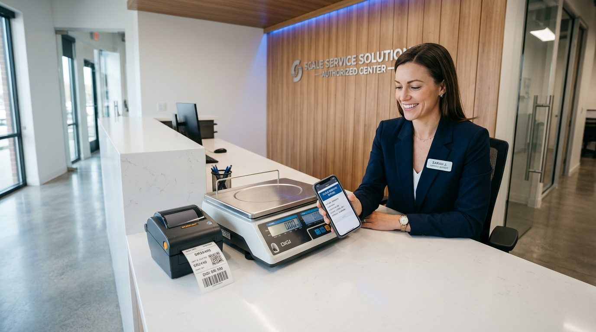
        <p align="center"><em>1. Balcão de Recepção: Atendimento Ágil com CNPJ em Tempo Real e Fotos</em></p>
      </td>
      <td width="50%">
        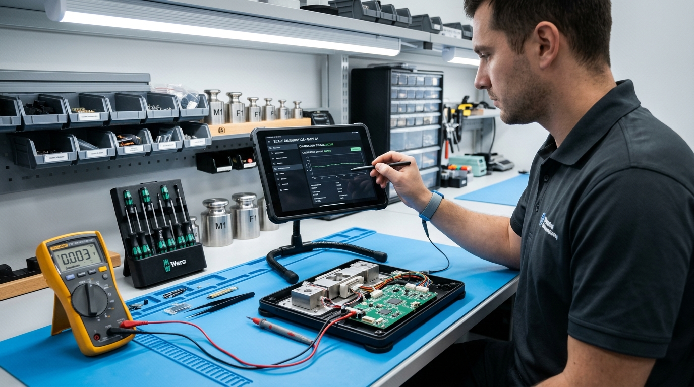
        <p align="center"><em>2. Bancada Técnica: Laudo Digital via QR Code e Catálogo Toledo Prix</em></p>
      </td>
    </tr>
    <tr>
      <td width="50%">
        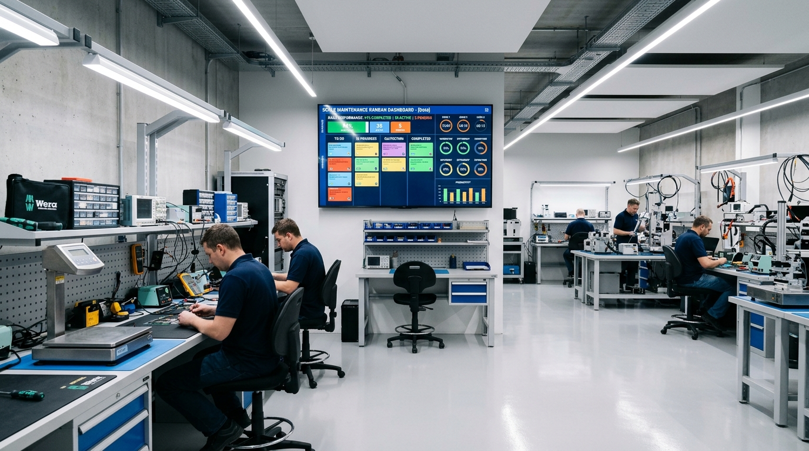
        <p align="center"><em>3. Chão de Fábrica: Smart TV 55" com WebSockets, Cronômetro de Estufa e Som</em></p>
      </td>
      <td width="50%">
        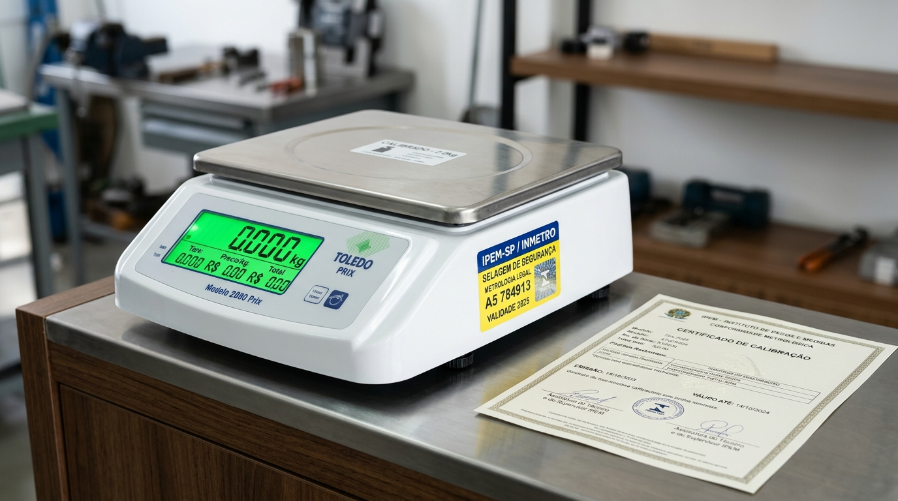
        <p align="center"><em>4. Expedição e Saída: Aplicação do Selo IPEM e Lacre de Segurança A5</em></p>
      </td>
    </tr>
  </table>
</div>

---

## 🖥️ Galeria das Telas do Sistema

### 1. Pré-Entrada de Balcão Mobile (`/recepcao` ou `/recepcao-fotos`)
> **Operado pela Priscila via Celular ou Computador**  
> Digitação do CNPJ com preenchimento instantâneo dos dados da Receita Federal (BrasilAPI), conferência rápida de acessórios recebidos (`[✓] Prato`, `[✓] Fonte`, `[✓] Cabo`, `[✓] Bateria`), upload de fotos 360° e geração imediata da Ordem de Serviço A4 para assinatura do cliente. O equipamento aguarda como *"Aguardando Teorema"* sem poluir a TV da oficina até a O.S. oficial ser vinculada.

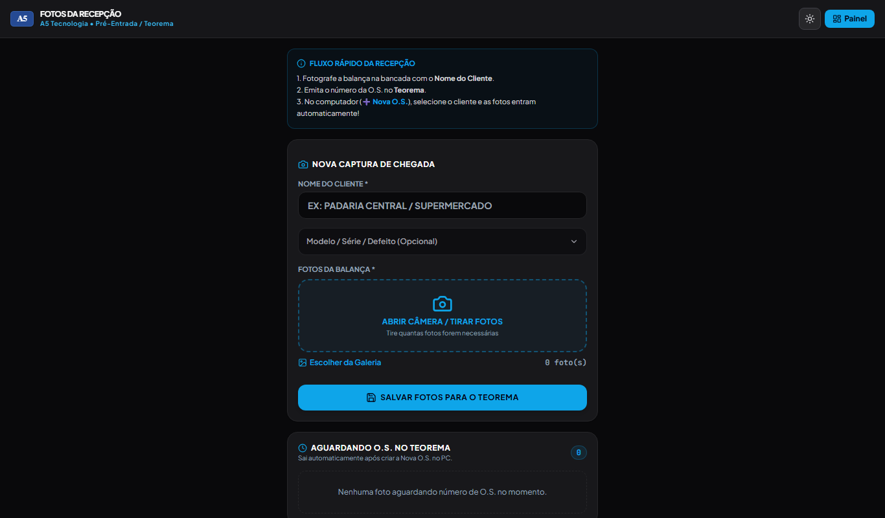

---

### 2. Etiqueta Térmica Adesiva 60x40mm (`/etiqueta/<os_number>`)
> **Impressão em Bobina Térmica Contínua (Zebra, Elgin, Argox, Bematech)**  
> Impressa no padrão metrológico com margens zeradas: logotipo oficial A5, número da O.S. gigante em alto contraste ao lado do nome do cliente, grade 2x2 com checklist visual dos acessórios entregues e QR Code de 19mm para leitura óptica rápida na bancada.

<div align="center">
  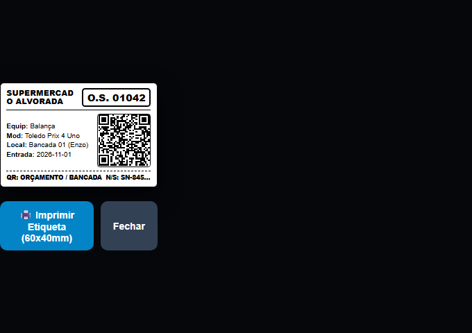
</div>

---

### 3. Painel Kanban da Recepção & Gestão (`/admin`)
> **Centro de Comando Operado pela Priscila e Gerência**  
> Quadro Kanban interativo com Drag and Drop em tempo real. Notificações visuais e sonoras instantâneas quando um técnico conclui um orçamento ou solicita reabertura. Vinculação com 1 clique da O.S. gerada no ERP Teorema e controle completo do fluxo de oficina.

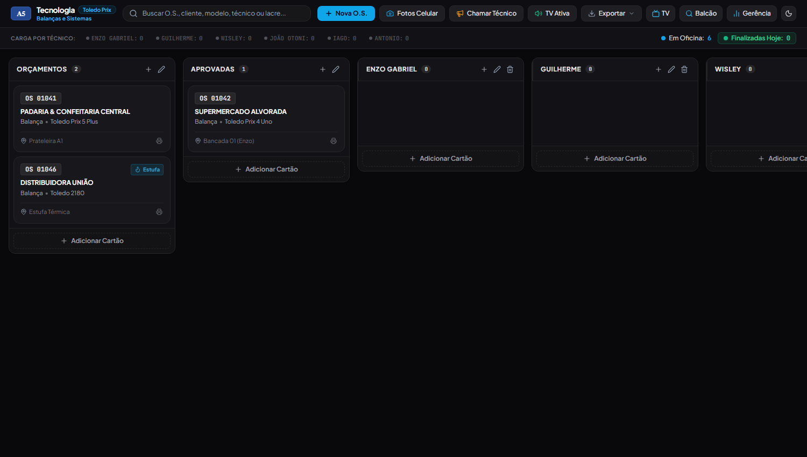

---

### 4. Bancada Mobile dos Técnicos (`/saida?os=<os_number>`)
> **Acessado nos Celulares dos Técnicos via Leitura do QR Code**  
> Exibe o histórico de fotos da entrada, defeito declarado e catálogo de peças integrado com códigos oficiais da **Toledo do Brasil** (Prix 4 Uno, Prix 5, Prix 6, 2090, 9094, etc.). Trava automática de segurança após conclusão do laudo.


---

### 5. Folha Digital de Orçamento e Histórico (`/folha/<os_number>`)
> **Prontuário Completo da O.S. para Auditoria e Impressão A4**  
> Exibe todas as peças substituídas com códigos de fábrica, valor de mão de obra, tempo de permanência na bancada, fotos antes/depois e termo de garantia técnica da A5.

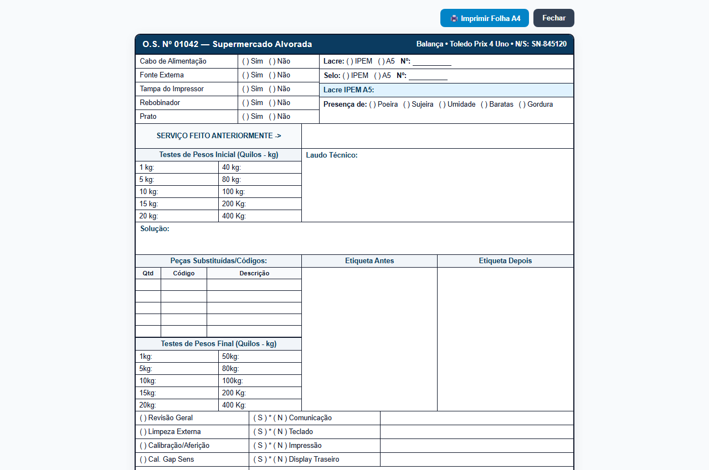

---

### 6. Painel Smart TV do Chão de Fábrica (`/tv` ou `/painel-tv`)
> **Display 55" na Parede da Oficina (Sem Teclado/Mouse)**  
> Visão em tempo real de todas as balanças da oficina, cronômetros regressivos para teste térmico de placas lógicas na estufa (1h / 2h com alarme sonoro), placar diário de balanças concluídas e rádio interna YouTube com *Audio Ducking* automático.

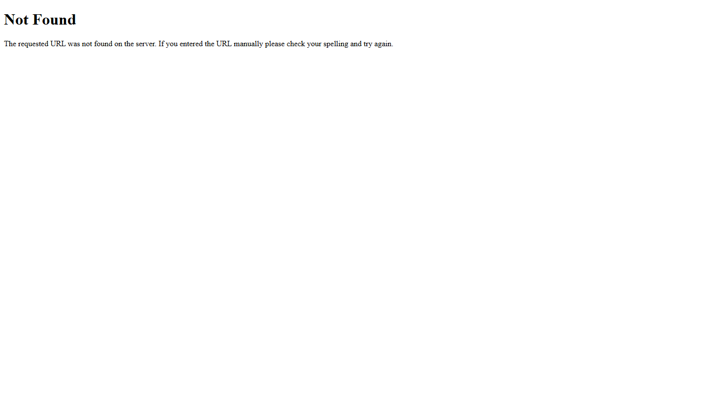

---

### 7. Sala da Diretoria & Intercom Neural (`/diretoria`)
> **Painel Executivo Exclusivo do Sr. Jacson**  
> Indicadores financeiros de orçamentos e peças, ranking de produtividade técnica, botão de backup em 1 clique e comunicador de voz com locução sintetizada em tempo real direto nas caixas de som da oficina.

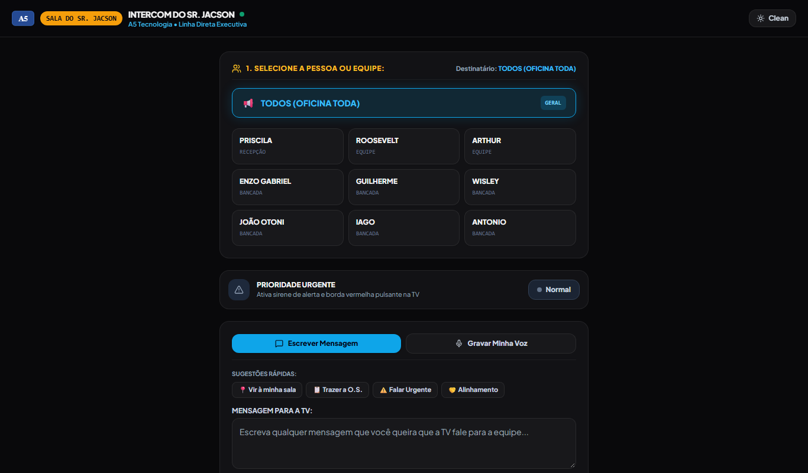

---

### 8. Telas Auxiliares: Consulta de Balcão e Métricas Gerenciais
<div align="center">
  <table>
    <tr>
      <td width="50%">
        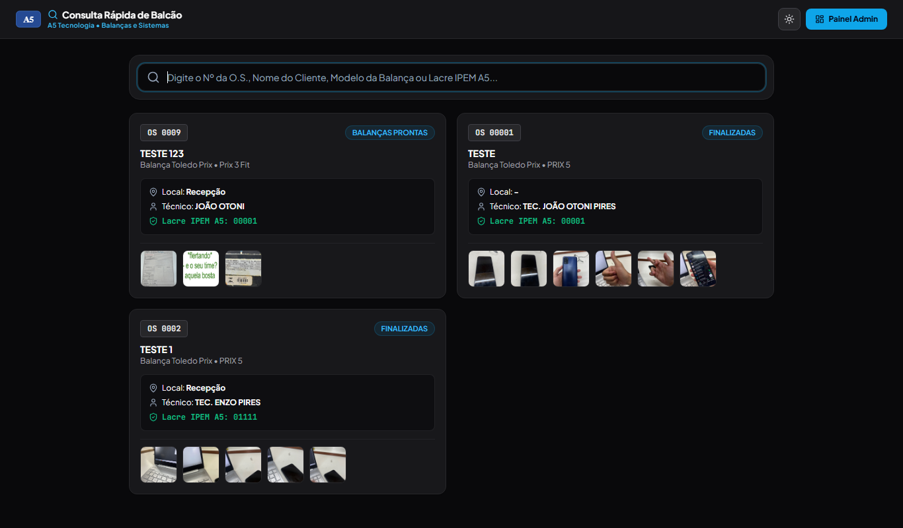
        <p align="center"><strong>Consulta Rápida (`/consulta`):</strong> Busca em 1s por O.S., cliente ou número de série, com botão de cópia de lacre para o Teorema.</p>
      </td>
      <td width="50%">
        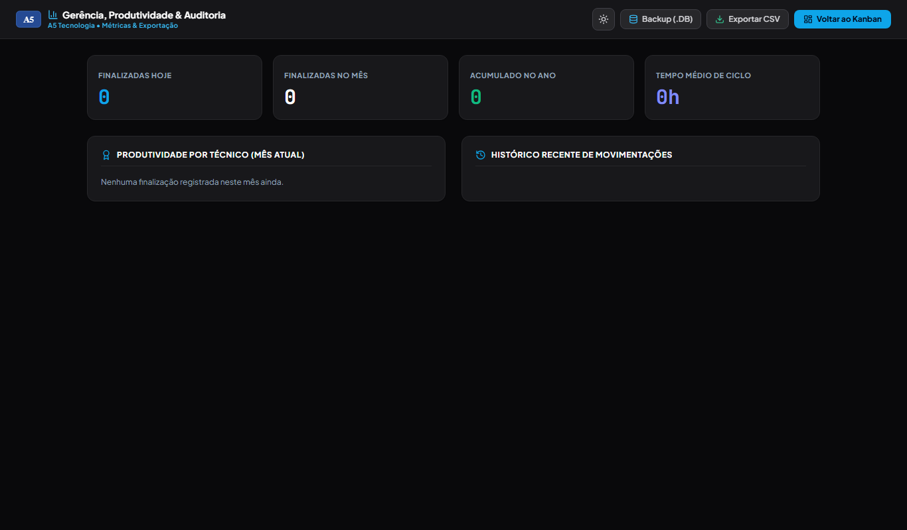
        <p align="center"><strong>Gerência & Histórico (`/gerencia`):</strong> Métricas de lead time, peças mais consumidas e relatórios mensais.</p>
      </td>
    </tr>
  </table>
</div>

---

## 🔄 Fluxo Operacional Ponta a Ponta

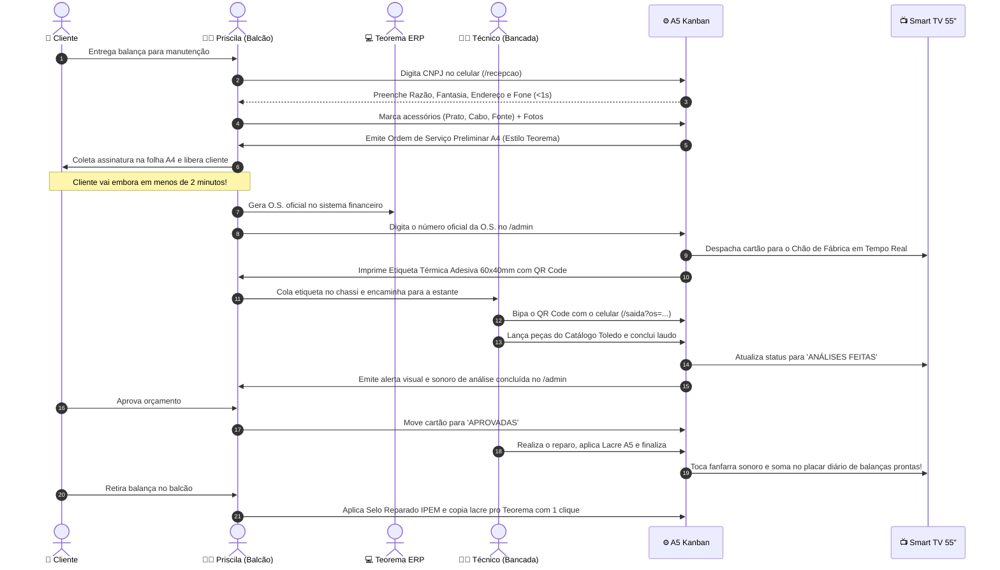

---

## ⚖️ Metrologia Legal & IPEM-AM

Toda intervenção técnica realizada pela A5 Tecnologia segue rigorosamente as normas metrológicas vigentes:
* **Lacre Físico de Segurança A5:** Aplicado pelo técnico no gabinete e chassi para impedir acesso indevido à calibração e à célula de carga.
* **Selo de Equipamento Reparado IPEM-AM:** Aplicado pela Priscila na entrega da balança ao cliente. O número do selo é registrado no sistema Kanban e transmitido ao Teorema ERP para prestação de contas metrológica.
* **Teste Térmico de Estufa:** Placas que sofrem intervenção com solda SMD ou substituição de componentes passam por ciclo térmico na estufa, controlado pelos cronômetros digitais da Smart TV.

---

## 🛠️ Tecnologias e Arquitetura

* **Backend:** Python 3.11+, Flask 3.x, Flask-SocketIO (WebSockets / Engine.IO).
* **Banco de Dados:** SQLite3 com `journal_mode=WAL` (Write-Ahead Logging), conexões reutilizadas para evitar travamentos de concorrência (`sqlite3.OperationalError: database is locked`) e migrações automáticas de schema.
* **Frontend:** HTML5 semântico, Tailwind CSS compilado localmente, Lucide Icons e Vanilla JS de alta performance.
* **Geração de QR Code:** Biblioteca `qrcodejs` client-side em alta definição.
* **Resiliência:** Operação autônoma em rede local (intranet). Se a conexão com a internet cair, toda a oficina e a TV continuam operando normalmente sem interrupções.

---

## 📦 Instalação e Execução

### 1. Clonar o Repositório
```bash
git clone https://github.com/joaovotonic/a5_kanban.git
cd a5_kanban
```

### 2. Ativar Ambiente Virtual e Instalar Dependências
```powershell
# Windows
python -m venv .venv
.\.venv\Scripts\Activate.ps1
pip install -r requirements.txt
```

### 3. Executar o Servidor
```powershell
python app.py
```
O servidor estará acessível na porta `5000`:
* **Recepção Mobile / Pré-Entrada:** `http://localhost:5000/recepcao`
* **Painel Kanban da Priscila:** `http://localhost:5000/admin`
* **Smart TV da Oficina:** `http://localhost:5000/tv` (ou `/painel-tv`)
* **Sala da Diretoria (Sr. Jacson):** `http://localhost:5000/diretoria`
* **Apresentação Executiva Comercial:** `http://localhost:5000/apresentacao`
* **Bancada Mobile dos Técnicos:** `http://localhost:5000/saida?os=01042`
* **Consulta Rápida de Balcão:** `http://localhost:5000/consulta`

---

## ✅ Testes Automatizados

A aplicação conta com suíte de testes unitários e de integração cobrindo 100% dos fluxos essenciais (criação de O.S., pré-entradas, busca de CNPJ, ciclo de vida do cartão, emissão de comprovantes A4 e rotas web):

```powershell
python -m unittest tests/test_kanban.py
```

```text
Ran 8 tests in 0.531s
OK (100% dos testes aprovados)
```

---

<div align="center">
  <sub>Desenvolvido com excelência técnica para a <strong>A5 Tecnologia • Balanças & Sistemas</strong> • Manaus / AM</sub>
</div>
